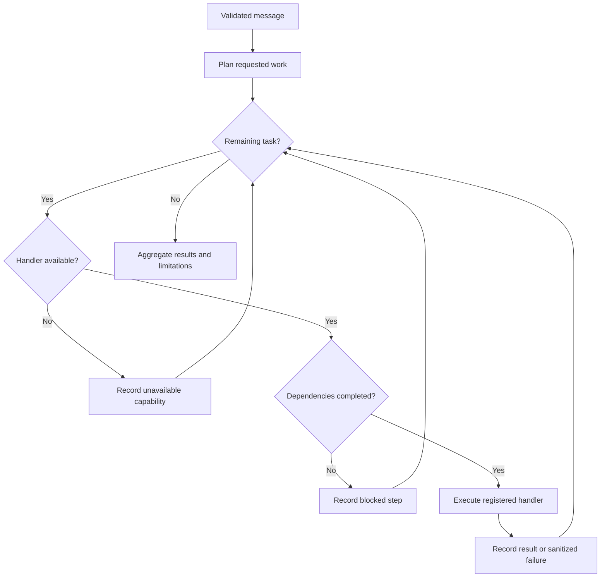

# Supervisor architecture and behavior

`POST /api/v1/agents/supervisor/chat` accepts `{"message": "..."}`. It preserves
the existing `POST /api/v1/agents/data/chat` endpoint and the Python
`supervisor.invoke({"message": "..."})` entry point.

## Request lifecycle

LangGraph coordinates state transitions with conditional edges. The router plans
work; a server-owned handler registry decides which capabilities actually exist.
Currently the registry contains **only Data Agent**. Research and Action are
recognized intents, not working implementations.

Clear English requests use deterministic rules. Examples include delayed/late/
overdue orders, open/unresolved tickets, explicit policy requests, and email
draft requests. Policy questions that merely mention delayed orders do not query
customer records. Separate clauses can request several agents. For ambiguous
business language or tightly coupled filtered requests, one Responses API call
returns a validated `ClassifiedRequest`. Non-business questions get a capability
explanation without a model call. This is a scoped router, not general language
understanding; classification quality still needs optional live evaluation.

The model can supply three subquestions and a limitation. It cannot supply an
executable tool, SQL, an arbitrary agent, or a graph edge. Server code constructs
at most one task per agent in Data → Research → Action order. Actions depend on
earlier evidence. A failed dependency blocks an available downstream handler;
independent evidence retrieval may continue. A registry extension test uses fake
handlers to prove this contract; it does not implement Research or Action.

## State and response

- `workflow_id`: generated UUID for correlation; **not persisted** yet.
- `routing`: method, explanation, tasks, dependencies, and limitations.
- `results`: per-agent answer, completion state, and safe error code.
- `events`: ordered routing, execution, and finalization records.
- `status`: `completed`, `partial`, `unsupported`, or `failed`.
- `answer`: collected agent results plus explicit limitations. No extra model
  call is used to invent missing evidence or merge unavailable capabilities.

Successful data retrieval plus unavailable policy/email capabilities returns
`partial`. A request entirely for unavailable capabilities returns `unsupported`.
Both are HTTP 200 business outcomes. Routing failure or no successful result after
an agent failure returns HTTP 502 with its trace. Unexpected graph failures return
a generic HTTP 502 detail. Invalid requests return HTTP 422, including whitespace,
non-string messages, messages longer than 2,000 characters, and unknown fields.

Each invocation initializes fresh state. No conversational memory or cross-request
evidence is carried over. Logs contain workflow IDs, agent identifiers, and states;
they exclude raw requests, result records, and exception text. The returned trace
is agent-level; it does not yet record each Data Agent tool invocation.

## Bounds and grounding

- At most three unique agent tasks and eight LangGraph supersteps.
- At most one router model call (20-second SDK timeout, no retries, 1,000 output tokens).
- Data Agent retains at most five tool rounds and six model calls (30-second SDK
  timeout per call, no retries, 1,500 output tokens each).
- At most four tool calls in a batch; unknown tools, nonempty/malformed arguments,
  or duplicate call IDs reject the entire batch before database access.
- Initial data response requires a tool call. Answers without any database evidence,
  empty answers, and incomplete responses fail instead of appearing successful.
- Only predefined read-only queries can execute. Current queries remain unbounded;
  milestone 2 must add bounded retrieval and exact aggregate tools together so a
  limited result set is never presented as a complete count.

SDK timeouts are per request, not a total workflow deadline. Database statement
timeouts, server rate limits, persistent execution, authorization, and tenant
isolation are still pending. Keep this prototype local with synthetic data.

## Adding a real agent later

Implement a handler `(AgentTask, tuple[AgentResult, ...]) -> str`, enforce its
authorization and evidence requirements, and register it only after its tests
pass. Research will need a richer citation/evidence contract and Action will need
persisted drafts and approvals; these should extend the response models. The
bounded scheduler and dependency checks do not need replacement.

## Verification

`backend/tests/fixtures/routing.json` contains deterministic routing examples.
`test_supervisor.py` covers routing, structured fallback, state transitions,
dependency failures, registry extension, validation, safe errors, independent
requests, OpenAPI, and the API → graph → Data Agent → tool path with mocked
external boundaries. Data Agent tests cover tool arguments, empty results,
five-round boundaries, incomplete responses, and upstream/database failures.
Routine tests make no live OpenAI requests.

Implementation references: [LangGraph graph API](https://docs.langchain.com/oss/python/langgraph/graph-api)
and [OpenAI function calling](https://developers.openai.com/api/docs/guides/function-calling).
